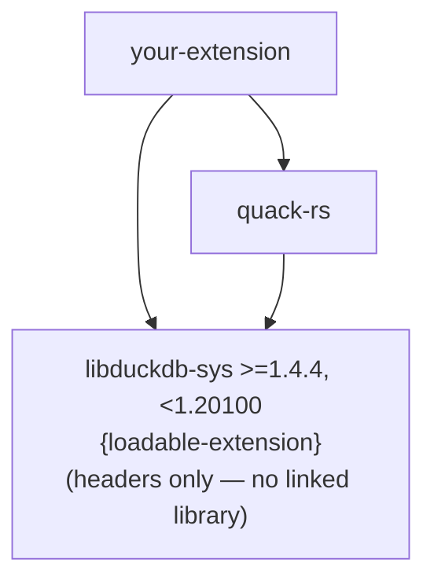

# Extension Anatomy

A DuckDB loadable extension is a shared library (`.so` / `.dylib` / `.dll`) that DuckDB loads
at runtime. This page covers what DuckDB expects of a Rust extension built on the C Extension
API: the entry-point symbol, the initialization sequence, the `loadable-extension` dispatch
table, and version and binary compatibility.

---

## The initialization sequence

When DuckDB loads your extension, it:

1. Opens the shared library and looks up the symbol `{name}_init_c_api`, where `{name}` is
   the extension name
2. Calls that function with an `info` handle and a pointer to a `duckdb_extension_access`
   struct (the `set_error`, `get_database` and `get_api` callbacks)
3. Your function must:
   1. Call `duckdb_rs_extension_api_init(info, access, api_version)` to initialize the dispatch table
   2. Get the `duckdb_database` handle via `access.get_database(info)`
   3. Open a `duckdb_connection` via `duckdb_connect`
   4. Register functions on that connection
   5. Disconnect
   6. Return `true` (success) or `false` (failure), reporting any error through `access.set_error`

`quack_rs::entry_point::init_extension` performs this sequence. It also checks the C API
layout before registration (see [ABI Compatibility](abi.md)) and converts a panic in your
registration code into a load error. The `entry_point!` macro generates the required
`#[no_mangle] extern "C"` symbol:

```rust
# use quack_rs::entry_point;
# use quack_rs::error::ExtensionError;
# fn register(_con: libduckdb_sys::duckdb_connection) -> Result<(), ExtensionError> { Ok(()) }
entry_point!(my_extension_init_c_api, |con| register(con));
// emits: #[no_mangle] pub unsafe extern "C" fn my_extension_init_c_api(...)
```

---

## Symbol naming

The symbol name **must** be `{extension_name}_init_c_api`. Extension names use lowercase ASCII
letters, digits and underscores only (no hyphens, which cannot appear in a C symbol).
If the symbol is missing or misnamed, DuckDB fails to load the extension.

```text
Extension name: "word_count_ext"
Required symbol: word_count_ext_init_c_api
```

Pass the full symbol name to `entry_point!`. The exported name then appears verbatim at the
call site; the macro does not build identifiers at compile time.

---

## The `loadable-extension` feature

With `features = ["loadable-extension"]`, `libduckdb-sys` does not link DuckDB; every C API
function dispatches through a table of function pointers instead:

```text
Without feature:  duckdb_query(...)  →  calls linked libduckdb directly
With feature:     duckdb_query(...)  →  dispatches through an AtomicPtr table
```

The `AtomicPtr` table starts as null. The extension's entry point fills it by calling
`duckdb_rs_extension_api_init`, which copies the pointers out of the API struct DuckDB
provides. This means:

- **Any call before `duckdb_rs_extension_api_init` panics** with
  `"DuckDB API not initialized or DuckDB feature omitted"`
- **In a plain `cargo test`, you cannot call any `duckdb_*` function** — no DuckDB host
  process ever initializes the table

This is why `quack-rs` offers `AggregateTestHarness` for testing: it simulates the aggregate
lifecycle in pure Rust, without calling the DuckDB API. For SQL-level tests, the
`bundled-test` / `bundled-test-prebuilt` features link a real DuckDB and fill the table
when `InMemoryDb::open()` runs (see [Testing Guide](../testing.md)).

---

## Dependency model



The `loadable-extension` feature produces a shared library that **does not statically link
DuckDB**. Instead, it receives DuckDB's function pointers at load time, so the extension runs
inside the host DuckDB process and uses that process's DuckDB instance, memory and threads.

---

## Version support

`libduckdb-sys = ">=1.4.4, <1.20100"` — the bounded range is intentional.

With the default features, quack-rs supports DuckDB 1.4.4 through 2.0.x. Every one of
them loads extensions built for **C API version `v1.2.0`**
(the version string passed to `duckdb_rs_extension_api_init`, `quack_rs::DUCKDB_API_VERSION`).
DuckDB 1.5.6 and 2.0.x declare C API version `v1.5.6` and still accept `v1.2.0` extensions. CI runs
the test suite against DuckDB 1.4.4, 1.4.5, 1.5.0, 1.5.3, 1.5.4, 1.5.5, 1.5.6 and 2.0.0, and loads the example
extension into 1.4.4, 1.5.0, 1.5.5, 1.5.6, 2.0.0 and the latest release. An extension that uses a
`duckdb-1-5*` feature is narrower: it loads into DuckDB 1.5.6 and 2.0.0, the releases whose layout
quack-rs has verified, and under the default `Strict` policy it refuses any other release (such as a
future 2.0.1) until quack-rs lists it or you build with `QUACK_RS_TARGET_DUCKDB_VERSION` set to it
([ABI Compatibility](abi.md#unknown-duckdb-versions)).
Using a range rather than an exact pin means:

- Extension authors can choose which `libduckdb-sys` release to build against (for example
  `=1.4.4` for DuckDB 1.4.4, or `~1.10505.0` for DuckDB 1.5.5, which `libduckdb-sys`
  numbers `1.10505.x`) and still resolve against `quack-rs`
- `quack-rs` itself doesn't force a DuckDB downgrade on users

`libduckdb-sys` encodes DuckDB `vMAJOR.MINOR.PATCH` as
`1.(10000·MAJOR + 100·MINOR + PATCH).N`, so DuckDB 2.0.0 is `1.20000.0` and the range
admits the whole DuckDB 2.0 bindings, `1.20000.x`. That release was published on
2026-10-22; it declares `rust-version` 1.88, so a Rust 1.86 toolchain cannot build it,
and MSRV-aware resolution (resolver 3, or `CARGO_RESOLVER_INCOMPATIBLE_RUST_VERSIONS=fallback`)
keeps a 1.86 build on `1.10506.x`.

**Why the range stops at `1.20100`.** That is the DuckDB 2.1 bindings. quack-rs names the
C API through the `libduckdb_sys` crate root, which the 1.20000 bindings keep only through
a re-export of their `v1` module that is marked `// TODO: Remove in the future` upstream;
quack-rs's exported macros hard-code those root paths too, so an extension that uses them
would break with it. quack-rs widens the bound for each DuckDB minor after testing it. If you
want the newer bindings before that, there is no override: wait for the quack-rs release
(see [Installation](../getting-started/installation.md#adding-quack-rs-to-an-existing-extension)).

> **For your own extension's `Cargo.toml`:** an extension that uses only the stable C API
> (the default quack-rs features) can keep the same `">=1.4.4, <1.20100"` range; this is
> what `scaffold::generate_scaffold` writes. An extension that enables the `duckdb-1-5*` features must pin
> `libduckdb-sys` to the bindings it is stamped for: `~1.10506.0` (the v1.5.2 – v1.5.6 layout)
> for C API `v1.5.6`, which is what the scaffold writes for `target_duckdb_version = "v1.5.6"`;
> or, for a `C_STRUCT_UNSTABLE` build pinned to one 1.x release, that release's bindings
> (`~1.10505.0` for `v1.5.5`). See [ABI Compatibility](abi.md).

---

## Binary compatibility

Which DuckDB releases accept an extension binary depends on the ABI type stamped into its
metadata footer:

- A `C_STRUCT` binary targeting C API `v1.2.0` (the default, stable API only) loads into
  every DuckDB release whose C API version is at least `v1.2.0` on the platform it was
  built for. That includes every release quack-rs supports (1.4.4 and later); quack-rs does
  not test releases before 1.4.4
- A `C_STRUCT` binary targeting C API `v1.5.6` (`quack_rs::DUCKDB_API_VERSION_1_5_6`) loads
  into DuckDB 1.5.6 and 2.0.0; 1.5.5 and earlier refuse it at `LOAD`. Stamp builds that use
  the `duckdb-1-5*` features this way, built against the 1.5.6 bindings; quack-rs's runtime
  layout check is the backstop when the stamp is missing
- A `C_STRUCT_UNSTABLE` binary loads only into the exact DuckDB 1.x release it names. DuckDB
  2.0 cannot load one: it routes every `C_STRUCT_UNSTABLE` binary to the C API v2 entry
  point `<name>_init_c_api_v2`, which quack-rs does not generate
- DuckDB checks the footer's platform and version fields at load time and refuses a mismatch
- Core and community extensions are signed; a binary you build locally is not
- To load an unsigned extension during development, start DuckDB with `allow_unsigned_extensions`
  enabled (`duckdb -unsigned` in the CLI); the setting cannot be changed on a running database
- The community extension CI builds and signs each extension for every supported platform
